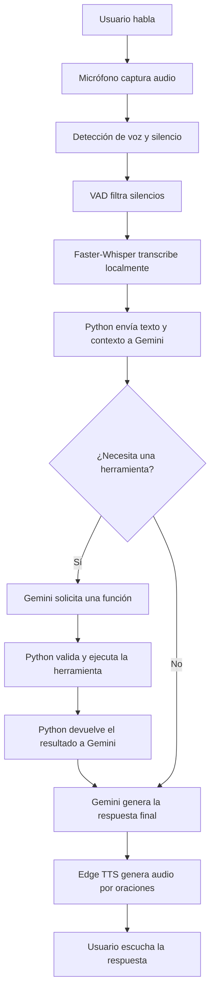
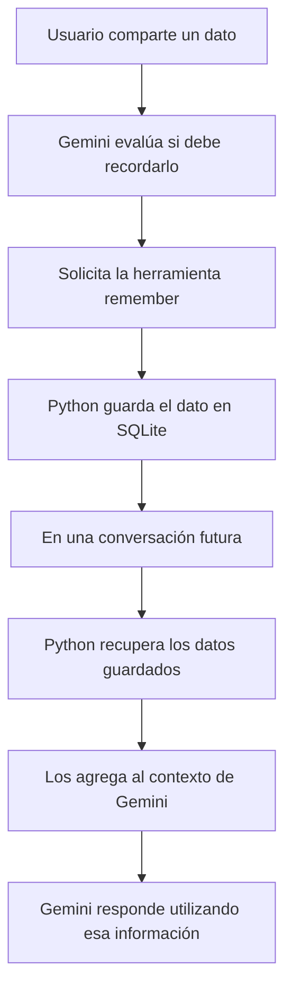

# JARVIS: asistente de voz local con IA en la nube

> Notas estructuradas a partir de los subtítulos del video. Se conserva la arquitectura, las decisiones técnicas, el funcionamiento y los pasos de implementación descritos por el autor.

## 1. Objetivo del proyecto

Construir un asistente personal llamado **JARVIS** que pueda:

- Escuchar comandos de voz y convertirlos en texto.
- Responder mediante voz.
- Recordar información del usuario y conversaciones recientes.
- Ejecutar acciones en el ordenador mediante herramientas programadas en Python.
- Mostrar una interfaz visual en una ventana propia.
- Recibir instrucciones desde Telegram y ejecutarlas en el mismo ordenador.

El proyecto busca funcionar en un PC antiguo sin necesidad de pagar por los servicios utilizados. La mayor parte del sistema se ejecuta localmente y el razonamiento se delega a un modelo en la nube.

## 2. Arquitectura general

El autor divide el asistente en estos componentes:

| Componente | Responsabilidad | Tecnología mencionada |
|---|---|---|
| Oídos | Capturar la voz y convertirla en texto | Micrófono, VAD y Faster-Whisper |
| Cerebro | Interpretar solicitudes y decidir qué herramienta utilizar | Google Gemini |
| Boca | Convertir las respuestas en voz | Edge TTS |
| Memoria | Guardar conversaciones recientes y datos permanentes | SQLite |
| Manos | Ejecutar acciones en el ordenador | Funciones de Python |
| Interfaz | Mostrar el estado, la conversación y las acciones | Página web local y Server-Sent Events |
| Acceso remoto | Recibir comandos desde el teléfono | Bot de Telegram |

### 2.1. Distribución local y en la nube

El primer intento consistió en ejecutar todo el modelo de IA en el ordenador. En el hardware antiguo del autor, una respuesta tardaba más de un minuto, por lo que la experiencia no era adecuada para una conversación.

La solución fue dividir el trabajo:

- **En el ordenador:** grabación de voz, reconocimiento de voz, memoria, ejecución de herramientas e interfaz.
- **En la nube:** razonamiento mediante Gemini.

El audio no se envía a Gemini. Whisper lo convierte localmente en texto y únicamente ese texto se envía al modelo. La respuesta de Gemini vuelve al ordenador.

**Privacidad:** la grabación de voz permanece en el equipo según la arquitectura descrita. Sin embargo, el texto reconocido sí se transmite a Google para procesarlo.

## 3. Oídos: reconocimiento de voz

### 3.1. Detección del inicio y final de la voz

El micrófono captura audio en fragmentos pequeños, de aproximadamente **0,1 segundos**. El programa mide el volumen de cada fragmento.

El mecanismo funciona así:

1. Detecta que el usuario comenzó a hablar.
2. Conserva los fragmentos de audio mientras hay voz.
3. Cuando detecta aproximadamente **0,7 segundos de silencio**, considera que el usuario terminó.
4. Detiene la grabación y procesa el audio.

Dos parámetros importantes:

- **Duración del silencio:** si es demasiado larga, la respuesta se siente lenta; si es demasiado corta, puede cortar al usuario mientras habla.
- **Umbral de volumen:** determina qué intensidad debe tener el audio para considerarse voz. Se puede reducir si el asistente no detecta bien al usuario o aumentar si el ruido del ventilador activa constantemente la grabación.

### 3.2. Faster-Whisper

El proyecto utiliza **Faster-Whisper**, una implementación optimizada de Whisper que se ejecuta localmente en el procesador y funciona sin conexión.

Características:

- Convierte la voz en texto.
- No necesita enviar el audio a un servidor.
- En el equipo del autor, normalmente procesa una oración en menos de un segundo.
- Puede utilizar distintos tamaños de modelo.

El autor utiliza el modelo **base en inglés**, por su velocidad. Si la precisión no es suficiente, recomienda cambiar al modelo **small**, sacrificando algo de velocidad para mejorar el reconocimiento.

### 3.3. Detección de voz y silencios

Antes del reconocimiento, un detector de actividad de voz (**VAD**) elimina los fragmentos en los que nadie está hablando.

Esto ayuda a reducir errores en los que Whisper interpreta el ruido de fondo como palabras.

### 3.4. Corrección de nombres propios

Al principio, Whisper no reconocía correctamente el nombre «Jarvis». La solución fue proporcionar una indicación o *prompt* antes del reconocimiento, por ejemplo:

> Talking to Jarvis, my AI assistant.

Esto le da contexto al modelo para reconocer correctamente nombres y términos específicos.

## 4. Cerebro: razonamiento y uso de herramientas

### 4.1. El modelo no ejecuta acciones directamente

Un modelo de lenguaje, por sí solo, recibe y genera texto. No puede abrir Notepad ni buscar en Internet por cuenta propia.

Para permitir esas acciones, el programa le proporciona un conjunto de herramientas (*tools*).

Cada herramienta es una función normal de Python que incluye:

- Un nombre.
- Una descripción breve de lo que hace.
- Los parámetros que necesita.

Gemini recibe el listado de herramientas junto con cada mensaje y decide si debe responder directamente o solicitar la ejecución de una función.

### 4.2. Ciclo de ejecución de herramientas

Ejemplo: el usuario dice «Abre Notepad».

1. El usuario habla.
2. Whisper convierte la voz en texto.
3. El texto se envía a Gemini.
4. Gemini solicita ejecutar la herramienta `open_app` con el parámetro `notepad`.
5. El programa ejecuta la función de Python.
6. La función devuelve el resultado, por ejemplo, `Opened notepad`.
7. El programa envía ese resultado a Gemini.
8. Gemini genera una respuesta natural.
9. El sistema convierte la respuesta en voz.

Por tanto, una acción suele requerir **dos llamadas al modelo**: una para decidir qué herramienta ejecutar y otra para formular la respuesta después de conocer el resultado.

El código de Python actúa como intermediario y mantiene el control de las acciones reales.

### 4.3. Personalidad e instrucciones del sistema

La personalidad se define mediante instrucciones que se envían antes de cada conversación.

Ejemplo utilizado por el autor:

- Ser un asistente británico, tranquilo e ingenioso.
- Llamar al usuario «sir».
- Responder en una o dos oraciones.

La brevedad es importante porque las respuestas se reproducen en voz alta. Sin esa instrucción, el asistente podría generar párrafos demasiado extensos.

### 4.4. Selección del modelo y manejo de límites

El autor probó diferentes modelos de Gemini:

- El modelo Flash habitual presentó tiempos de espera de hasta 19 segundos.
- El modelo Flash-Lite respondió aproximadamente en 0,6 segundos en sus pruebas y fue suficiente para respuestas habladas breves.

El nivel gratuito de Gemini tiene límites diarios que dependen del modelo. Se pueden consultar en la página de límites de uso de **Google AI Studio**.

El programa contempla errores y saturación:

1. Si Google informa que el servicio está sobrecargado, espera un momento.
2. Vuelve a intentarlo.
3. Si es necesario, cambia a un modelo alternativo.
4. Si todos los intentos fallan, informa al usuario mediante voz en lugar de bloquearse o cerrarse.

**Importante:** los límites gratuitos pueden cambiar y no son iguales para todos los modelos.

## 5. Boca: generación de voz

### 5.1. Edge TTS

El proyecto utiliza **Edge TTS**, una biblioteca que permite acceder al servicio de texto a voz utilizado por la función de lectura en voz alta de Microsoft Edge.

Ventajas mencionadas:

- Voces naturales.
- Diferentes idiomas y acentos.
- Voces británicas.
- No requiere crear una cuenta ni configurar una clave API.

Limitación: el procesamiento se realiza en servidores de Microsoft, por lo que necesita conexión a Internet.

### 5.2. Reproducción por oraciones

Para reducir la latencia, el sistema no espera a convertir toda la respuesta en audio.

En su lugar:

1. Genera el audio de la primera oración.
2. Comienza a reproducirlo.
3. Mientras habla, prepara el audio de la siguiente oración.
4. Continúa hasta terminar la respuesta.

Según los registros del autor, normalmente transcurre menos de un segundo entre el final del razonamiento y la primera palabra pronunciada.

La voz se puede cambiar desde la configuración del módulo de voz. También es posible sustituir Edge TTS por un motor que funcione sin conexión, aunque el autor advierte que muchas alternativas offline suenan menos naturales.

## 6. Memoria: persistencia con SQLite

### 6.1. Almacenamiento

La memoria se almacena en **SQLite**, una base de datos que puede guardarse en un único archivo local y no necesita un servidor independiente.

El autor separa la información en dos categorías:

| Tipo de memoria | Contenido | Comportamiento |
|---|---|---|
| Conversación reciente | Mensajes intercambiados recientemente | Conserva los últimos 10 mensajes, aproximadamente cinco intercambios |
| Datos permanentes | Hechos relevantes sobre el usuario | Se mantienen entre sesiones hasta que se eliminen |

### 6.2. Cómo aprende un dato

Guardar información es otra herramienta disponible para Gemini.

Ejemplo:

1. El usuario dice: «Recuerda que hago videos de YouTube sobre IA».
2. Gemini decide que el dato merece conservarse.
3. Solicita ejecutar la herramienta `remember`.
4. Python guarda el dato en SQLite.
5. En futuras interacciones, los datos guardados se agregan a las instrucciones del modelo.

Así, cuando el usuario pregunta qué sabe sobre él, Gemini ya recibe esos datos en el contexto y no necesita buscarlos en otro lugar.

### 6.3. Por qué no enviar todo el historial

Enviar toda la conversación en cada solicitud aumenta el tiempo de procesamiento y consume más cuota del servicio gratuito.

Por eso, el autor limita el historial a los últimos **10 mensajes**, mientras que los datos permanentes se incluyen siempre.

### 6.4. Control del usuario

La memoria se guarda en un archivo local dentro de la carpeta de JARVIS.

Esto permite:

- Revisar qué información se ha almacenado.
- Modificar los datos manualmente.
- Eliminar el archivo para borrar la memoria guardada.

Como SQLite persiste en disco, la información continúa disponible después de cerrar y volver a iniciar el asistente.

## 7. Manos: automatización del ordenador

Las herramientas son funciones pequeñas de Python que permiten interactuar con el sistema operativo y otros servicios.

### 7.1. Acciones implementadas

El asistente puede:

- Abrir y cerrar aplicaciones.
- Reproducir canciones en YouTube.
- Bajar el volumen.
- Pausar música.
- Abrir sitios web.
- Buscar información en Internet.
- Leer archivos indicados por el usuario.

### 7.2. Restricciones de seguridad

Como las herramientas interactúan con el ordenador real, el autor establece límites:

- Solo puede abrir aplicaciones incluidas en una lista permitida.
- Solo puede leer archivos dentro de la carpeta de documentos autorizada.
- No puede cerrar Windows Explorer, porque podría afectar al escritorio completo.

La idea es que el modelo no tenga acceso ilimitado al sistema. El código determina qué acciones están permitidas.

### 7.3. Cómo agregar una nueva habilidad

Agregar una habilidad no requiere modificar el ciclo principal del agente.

Ejemplo: crear una herramienta que indique la hora.

1. Crear una función de Python que obtenga la hora actual.
2. Escribir una descripción clara debajo del nombre de la función.
3. Agregar la función al listado de herramientas disponibles.
4. Preguntar a JARVIS qué hora es.

Gemini verá la nueva herramienta y podrá solicitar su ejecución.

La descripción es especialmente importante: junto con el nombre y los parámetros, es la principal información que utiliza el modelo para decidir cuándo llamar a una herramienta.

### 7.4. No afirmar acciones que no se realizaron

El autor relata un error importante: antes de implementar una herramienta para cerrar aplicaciones, pidió a JARVIS que cerrara Notepad.

El asistente buscó en Internet cómo hacerlo y respondió que ya estaba hecho, aunque Notepad seguía abierto.

La solución fue:

1. Implementar una herramienta real para cerrar aplicaciones.
2. Hacer que la función devuelva si la operación tuvo éxito.
3. Añadir una instrucción para que JARVIS solo afirme que una acción se completó cuando el resultado de la herramienta lo confirme.

**Principio fundamental:** las herramientas deben informar lo que realmente ocurrió y el modelo debe comunicar ese resultado, no inventar que logró algo.

### 7.5. Limitaciones actuales

El asistente puede iniciar un video de YouTube, pero todavía no puede:

- Interactuar libremente con los elementos de una página web.
- Hacer clic en cualquier parte de una interfaz.
- Ver o interpretar la pantalla del ordenador.

Estas capacidades requieren una implementación adicional.

## 8. Interfaz gráfica

JARVIS también dispone de una interfaz visual que se abre en una ventana independiente.

### 8.1. Comunicación entre Python y la interfaz

Cuando ocurre un evento, el programa Python envía un pequeño mensaje a una página web local.

La interfaz recibe esos mensajes y actualiza:

- La conversación, en el lado izquierdo.
- La lista de herramientas y acciones, en el lado derecho.
- El estado visual del asistente.

### 8.2. Server-Sent Events (SSE)

La comunicación utiliza **Server-Sent Events (SSE)**.

Es una conexión unidireccional desde Python hacia la página web. Es suficiente para comunicar eventos y actualizar la interfaz en tiempo real.

La excepción es el botón de silencio (*mute*), que envía una pequeña solicitud desde la interfaz hacia Python para detener la escucha.

### 8.3. Estados visuales

La esfera central representa el estado del asistente:

- Mientras escucha, crece siguiendo el volumen de la voz.
- Mientras piensa, cambia a color ámbar.
- Mientras habla, pulsa siguiendo la reproducción de voz.

La ventana independiente permite mantener JARVIS visible mientras se trabaja en otras aplicaciones.

## 9. Acceso desde el teléfono mediante Telegram

El último componente permite interactuar con JARVIS desde cualquier lugar, siempre que el ordenador esté encendido y el programa se encuentre ejecutándose.

### 9.1. Configuración del bot

1. Crear un bot de Telegram mediante **BotFather**.
2. Conectar el bot con el programa JARVIS.
3. Enviar los mensajes recibidos a la misma función `think` que utiliza la versión de voz.

De esta manera, Telegram reutiliza:

- El mismo cerebro.
- La misma memoria.
- Las mismas herramientas.

Ejemplo: desde el teléfono se envía «Abre la calculadora» y el ordenador ejecuta la acción.

### 9.2. Comunicación con Telegram

Mientras el puente está activo, el programa consulta periódicamente a Telegram para comprobar si hay mensajes nuevos.

Cuando recibe uno, lo entrega a la función de razonamiento del asistente.

No es necesario configurar un servidor externo para esta modalidad básica, pero el ordenador debe permanecer encendido y ejecutando JARVIS.

### 9.3. Seguridad

El bot verifica el **ID de usuario de Telegram** de quien envía el mensaje.

- El usuario autorizado puede ejecutar comandos.
- Los demás reciben una respuesta de rechazo.

Esta comprobación es necesaria porque el bot puede ejecutar acciones en el ordenador.

### 9.4. Memoria compartida

Como Telegram utiliza el mismo cerebro y almacenamiento, la información aprendida por voz también está disponible al conversar desde el teléfono, y viceversa.

### 9.5. Disponibilidad permanente

Para acceder a JARVIS las 24 horas del día, sería necesario mantener el sistema alojado en un equipo o servidor que permanezca encendido. El autor deja el alojamiento permanente fuera del alcance del video.

## 10. Instalación y ejecución

El procedimiento descrito por el autor es el siguiente.

### 10.1. Obtener una clave de Gemini

1. Entrar en **Google AI Studio**.
2. Generar una clave gratuita de Gemini.
3. No activar la facturación para ese proyecto, según la recomendación del autor.
4. Consultar los límites del modelo en la página de límites de uso.

La disponibilidad y las condiciones del nivel gratuito pueden cambiar. Conviene revisar las condiciones actuales de Google antes de utilizarlo.

### 10.2. Descargar e instalar el proyecto

1. Descargar el código desde el enlace de la descripción del video.
2. Crear un entorno virtual de Python.
3. Instalar las dependencias indicadas en el archivo de requisitos.
4. Colocar la clave de Gemini en el archivo `.env`.
5. Ejecutar `Jarvis.py`.
6. Probar el asistente diciendo «Hello».

El entorno virtual evita conflictos entre versiones de paquetes de Python utilizados por distintos proyectos.

### 10.3. Solución de problemas

| Problema | Posible causa o solución |
|---|---|
| JARVIS no escucha | Comprobar que Windows permita a las aplicaciones de escritorio acceder al micrófono |
| Error de cuota | Se alcanzó el límite gratuito del modelo; esperar a que se restablezca |
| Reconocimiento incorrecto | Revisar el umbral de voz, el modelo de Whisper y el texto de contexto |
| El ventilador activa la escucha | Aumentar el umbral de volumen |
| JARVIS corta las frases | Aumentar el tiempo de silencio necesario para finalizar la grabación |
| Respuestas lentas | Revisar el modelo de Gemini y la generación de voz por oraciones |

El autor indica que el README del repositorio contiene las instrucciones y soluciones adicionales, incluida la configuración de Telegram.

## 11. Tecnologías utilizadas

| Tecnología | Uso en JARVIS |
|---|---|
| Python | Lógica principal, herramientas e integración de componentes |
| Google Gemini | Razonamiento y selección de herramientas |
| Google AI Studio | Obtención de la clave y consulta de límites |
| Faster-Whisper | Reconocimiento de voz local |
| Whisper | Modelo de reconocimiento de voz en el que se basa Faster-Whisper |
| VAD | Detección y eliminación de segmentos sin voz |
| Edge TTS | Conversión de texto a voz |
| SQLite | Almacenamiento persistente de memoria |
| Server-Sent Events | Comunicación de eventos hacia la interfaz |
| HTML / página web local | Interfaz gráfica |
| Telegram Bot API / BotFather | Comunicación desde el teléfono |
| `.env` | Almacenamiento de la clave de configuración |
| `venv` | Aislamiento de dependencias de Python |

## 12. Decisiones de arquitectura importantes

1. **Separar el razonamiento de la ejecución:** Gemini decide qué herramienta necesita, pero Python ejecuta la acción.
2. **Mantener local el procesamiento de audio:** el reconocimiento de voz ocurre en el ordenador; solo el texto se envía al modelo en la nube.
3. **Diseñar herramientas pequeñas:** cada habilidad es una función independiente y documentada.
4. **Limitar los permisos:** las herramientas solo deben acceder a recursos expresamente autorizados.
5. **Verificar los resultados:** el asistente no debe afirmar que completó una acción sin recibir confirmación.
6. **Persistir la memoria:** SQLite permite conservar datos entre sesiones sin desplegar un servidor de base de datos.
7. **Reducir la latencia:** utilizar modelos ligeros y generar la voz por partes.
8. **Reutilizar el mismo cerebro:** la voz y Telegram utilizan la misma lógica de razonamiento, memoria y herramientas.
9. **Manejar los fallos:** los reintentos y modelos alternativos evitan que una saturación temporal cierre el asistente.

## 13. Flujo completo de una interacción por voz

## 14. Flujo de memoria

## 15. Ideas para ampliar el proyecto

A partir de las capacidades y limitaciones mencionadas en el video, estas son posibles líneas de evolución:

- **Más herramientas:** integrar calendario, correo, archivos y aplicaciones adicionales.
- **Control de interfaz:** permitir que el asistente interactúe con páginas web y aplicaciones mediante clics y escritura.
- **Visión por computador:** permitir que interprete capturas de pantalla.
- **Memoria más avanzada:** clasificar, editar y recuperar información de forma más precisa.
- **Acceso remoto permanente:** alojar el componente de Telegram en un equipo disponible continuamente.
- **Mayor seguridad:** implementar permisos por herramienta, confirmaciones para acciones sensibles y registros de ejecución.

Estas ampliaciones son propuestas derivadas del proyecto; no forman parte de la implementación demostrada en el video.

## 16. Conceptos que conviene comprender

| Concepto | Qué significa en este proyecto |
|---|---|
| Speech-to-Text (STT) | Convertir audio en texto |
| Text-to-Speech (TTS) | Convertir texto en audio |
| VAD | Detectar qué partes de una grabación contienen voz |
| Tool Calling | Mecanismo por el que el modelo solicita ejecutar funciones externas |
| Agente de IA | Sistema que combina un modelo con herramientas y lógica de ejecución |
| Prompt del sistema | Instrucciones que definen el comportamiento del modelo |
| SQLite | Base de datos relacional almacenada en un archivo |
| Persistencia | Capacidad de conservar datos después de cerrar el programa |
| Latencia | Tiempo que transcurre entre una solicitud y su respuesta |
| SSE | Mecanismo para enviar eventos desde un servidor hacia una página web |
| Polling | Consultar periódicamente un servicio para comprobar si hay novedades |
| Entorno virtual | Entorno aislado para instalar dependencias de Python |

---

## Resumen

La idea central del proyecto no es ejecutar un modelo enorme en el ordenador, sino **construir un sistema modular alrededor de un modelo de lenguaje**.

Gemini aporta el razonamiento; Python controla la ejecución; Faster-Whisper escucha; Edge TTS habla; SQLite conserva la memoria; las herramientas permiten actuar sobre el ordenador; la interfaz muestra lo que ocurre y Telegram habilita el acceso remoto.

El componente más importante desde el punto de vista arquitectónico es el sistema de herramientas: el modelo propone acciones, pero el código local valida, ejecuta y devuelve resultados verificables.
